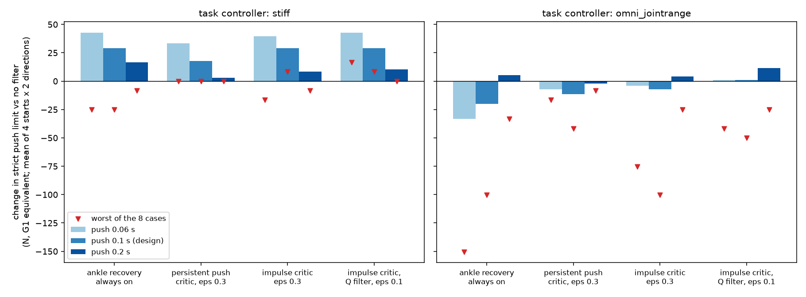
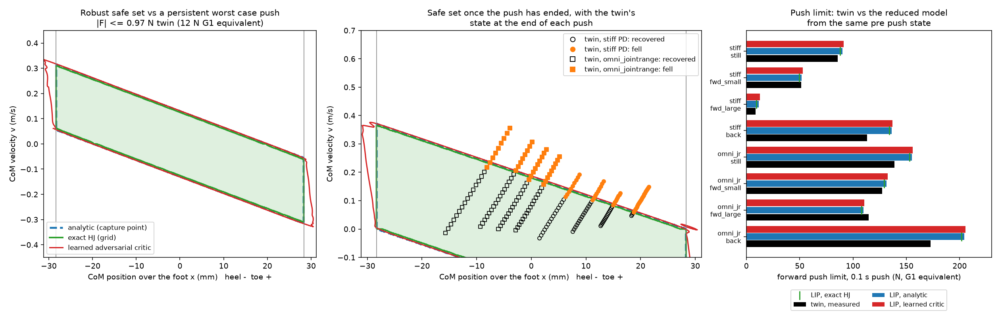

# When can a balancing robot still catch a shove?

I shove a small simulated Unitree G1 (the "twin") at the pelvis for 0.1 s and ask which body states it can still recover from. That region is the **safe set**. I compute it three ways on a reduced ankle model: a closed form capture point set, a grid Hamilton Jacobi (HJ) reachability solver, and a learned adversarial safety critic. Then I check the set against the twin and use the critic as a safety filter on two controllers.

## Main finding

The disturbance model has to match the shape of the real push, not just its size.

My first critic assumed a small push that never stops. As a filter it did almost nothing, because it only saw danger after most of the push had already happened. I could not just make that persistent push bigger: one large enough to cover the real 0.1 s shove leaves no safe states at all.

So I retrained the critic against **one bounded push of fixed duration, then nothing**, and added the remaining push time to its state. Used as a Q value filter (the form in Gameplay Filters and Q-CBF work), it raised the stiff PD controller's push limit by **29 N on average**, and it never did worse than no filter in any of the 24 cases I ran (3 push lengths × 4 starts × 2 directions). On my best learned policy it changed nothing on average (+1 N), because the ankle only recovery it switches to is weaker than what that policy already does.

## Setup

The twin is a MuJoCo model of the G1 at small scale. Forces in this README are converted to **G1 newtons** (twin force × 12).

| | |
|---|---|
| Push | forward or backward at the pelvis, 0.1 s of G1 time |
| Controllers | stiff PD, and a learned RL policy (`omni_jointrange`) |
| Starts | standing still, small forward lean, large forward lean, backward lean (a smaller push 10 control steps before the main one) |

The reduced model is a linear inverted pendulum (LIP) with an ankle that can move the center of pressure (CoP) within the foot:

| | |
|---|---|
| Mass | 2.68 kg |
| CoM height | 229 mm, so ω = 6.54 rad/s |
| Foot length | 56.7 mm |
| Ankle torque limit | 1.95 N m, enough for 74 mm of CoP offset, so the foot edge limits balance before the torque does |

## Results

### 1. Do the three methods agree?

Yes, with one weakness in the learned critic.

| Comparison | IoU, no push | IoU, worst case push |
|---|---:|---:|
| Capture point set vs grid HJ | 0.977 | 0.970 |
| Learned critic vs grid HJ | 0.93 | 0.91 |

The critic is **about 8% optimistic**: 8 to 9% of its safe set is states that HJ calls unsafe. It almost never errs the other way. For a safety filter this is the dangerous direction, since an optimistic critic will sometimes let the robot into a state it cannot recover from. The errors sit in a thin band just outside the capture point lines and at the foot edge corners, where the value is flattest.

Training needed the discount γ close to 1. A first run that stopped at γ = 0.99 was badly optimistic (about twice the HJ area, IoU 0.36 to 0.48), because a state that only fails 20 to 60 steps later still gets a positive discounted value. Annealing γ to 0.9995 fixed most of this. That run is kept in `data/gamma099/`.

### 2. Does the reduced model predict the twin's push limit?

Within 5% in four of eight cases. Otherwise it predicts too high, by up to 28%. HJ and the critic land within 2 to 3% of the capture point numbers below.

| Controller | Start | Twin (N) | Model (N) | Twin ÷ model |
|---|---|---:|---:|---:|
| Stiff PD | Standing | 86 | 90 | 0.95 |
| Stiff PD | Small forward lean | 51 | 52 | 0.99 |
| Stiff PD | Large forward lean | 8 | 12 | 0.72 |
| Stiff PD | Backward lean | 113 | 136 | 0.83 |
| Learned policy | Standing | 139 | 155 | 0.89 |
| Learned policy | Small forward lean | 127 | 131 | 0.97 |
| Learned policy | Large forward lean | 115 | 110 | 1.04 |
| Learned policy | Backward lean | 173 | 204 | 0.84 |

### 3. Does the twin ever survive outside the model's safe set?

No. In 207 trials every recovery ended inside it, and 11 falls ended inside it near the edge. The learned policy does roll onto its toe (up to 17° of foot pitch) and pitch its pelvis (about 5°), but that only gets it back into the region the ankle model already allows. Neither controller can step, which is probably why.

### 4. Does the critic work as a safety filter?

Change in the largest push survived, versus no filter, in G1 newtons. Each entry is the mean over 8 cases (4 starts × 2 directions), with the worst case in brackets. The critics were trained for the 0.1 s push.

| Controller | Filter | 0.06 s push | 0.1 s push | 0.2 s push |
|---|---|---:|---:|---:|
| Stiff PD | ankle recovery always on | +43 (−25) | +29 (−25) | +17 (−8) |
| Stiff PD | persistent push critic | +33 (0) | +18 (0) | +3 (0) |
| Stiff PD | **impulse critic, Q filter** | **+43 (+17)** | **+29 (+8)** | **+10 (0)** |
| Learned policy | ankle recovery always on | −33 (−150) | −20 (−100) | +5 (−33) |
| Learned policy | persistent push critic | −7 (−17) | −11 (−42) | −2 (−8) |
| Learned policy | **impulse critic, Q filter** | **+1 (−42)** | **+1 (−50)** | **+12 (−25)** |

For stiff PD the Q filter gets the full gain of forcing the ankles every step without ever losing to no filter, and it still helps at push lengths it was not trained on. For the learned policy the filter can only be as good as its recovery action. Replacing the ankles throws away the toe roll and the backward lean the policy already uses. Most of the remaining loss is at the backward lean start, which really is unsafe against a backward push, so a symmetric filter steps in and gives up the forward margin the lean was buying.

All 10 filter settings tested are in `data/filter_sweep.csv`.

## Method

**Grid HJ.** Value iteration of the discrete time HJI safety Bellman equation, semi Lagrangian on a 401 × 401 grid, using the exact linear flow map with dt = 30 ms. An earlier version with 5 ms Euler steps eroded the set by about 11% through interpolation diffusion.

**Learned critic.** Discounted safety backup Q = (1−γ)g′ + γ·min(g′, Q′), with a controller actor and a disturbance actor (disturbance learning rate 5× the controller's) and γ annealed from 0.9 to 0.9995.

**Impulse disturbance.** One push of up to ã in either direction, any shape, lasting the twin's push duration, then nothing. The networks see the remaining push time r as an extra input. At run time the filter asks whether a full push starting now could still be survived (r = 1). The critic used above was trained with ã = 2.0 (78 N); at ã = 3.0 no state is safe. Against the closed form impulse set its IoU is 0.93, and it is 7.5% optimistic.

**Q filter.** Each step, read the CoP the task controller is commanding and override only when Q(s, task CoP, worst push) < ε = 0.1. No latch. The override replaces both ankle pitch actions with the critic's CoP, using the map from `probe_ankle.py` (CoP ≈ −6 mm + 230 mm × action).

**Evaluation.** 36 push sizes from 0 to 290 N in 8 N steps. The push limit is the largest push such that every smaller push was survived.

## Limitations

- The critic is optimistic by about 8%. A deployed filter would need a margin or a verification step, such as gameplay rollouts.
- On this 2D model the capture point set is exact, so the learned critic adds nothing yet. It only earns its place in cases with no closed form, such as sideways pushes or stepping.
- Grid HJ is not reliable for the impulse case: it shrinks as the push is split into more backups (IoU 0.91 down to 0.79 for 5 to 40 backups), which is interpolation erosion. I used the closed form set as the reference there.
- Each case is one deterministic run, and push limits sit on an 8 N grid.
- The filter reads the CoM state straight from the simulator, not from an estimator.
- Sagittal pushes only.

## Next steps

- A better recovery action: blend the critic's CoP into the policy's own ankle command, or train a recovery policy on the twin.
- A CoM state estimator before trying this on hardware.
- Sideways pushes with a 4D LIP, checked against a level set solver such as `hj_reachability`.

