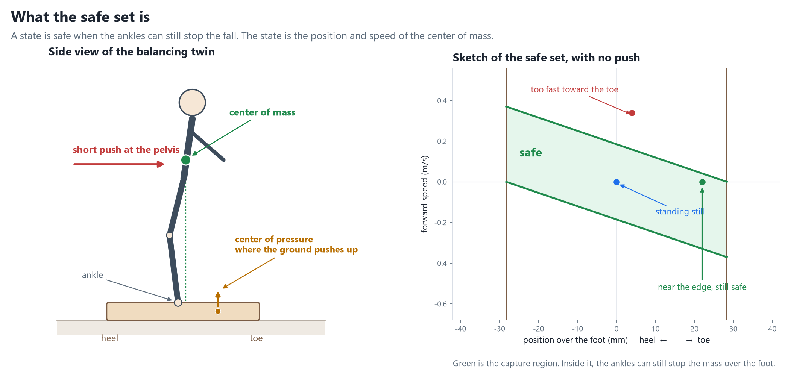

# When can this balancing robot still catch a shove?

A small simulated Unitree G1, the twin, is shoved at the pelvis for 0.1 s. A stick-and-foot model marks the **safe set**: the center-of-mass positions and speeds the ankles can still save. A formula, a grid solver, and a learned critic draw that set. They agree. The model predicts the shove the twin survives, usually a little high. As a filter, the critic helps a stiff pose controller. On the best learned policy the average gain is about zero, because an ankle-only rescue is weaker than the toe roll and the lean that policy already uses.

The twin weighs 2.68 kg. Its center of mass is 229 mm up, and its foot is 57 mm long. The foot limits balance before ankle torque does. Forces below are **G1 newtons** (twin force × 12). The four starts are standing still, a small forward lean, a large forward lean, and a backward lean.

| Question | Answer |
|---|---|
| Do the formula, the grid, and the critic agree? | Yes. Overlap is 0.97 and 0.92. The critic is about 8% optimistic, and it almost never marks a safe state as unsafe. |
| Does the model match the twin? | Within 5% in four of eight cases. Otherwise it is high, by up to 28%. |
| Can the twin survive outside that set? | No. In 207 trials, every recovery ended inside it. |
| Does the filter help? | Stiff joints: **+29 N** on average, and no trial gets worse. Learned policy: **+1 N** on average, worst trial −50 N. |

Shove the twin survives, in G1 newtons. The model column is the formula. The grid and the critic land within 2–3% of it.

| Controller | Start | Twin | Model | Twin ÷ model |
|---|---|---:|---:|---:|
| Stiff PD | Standing | 86 | 90 | 0.95 |
| Stiff PD | Small forward lean | 51 | 52 | 0.99 |
| Stiff PD | Large forward lean | 8 | 12 | 0.72 |
| Stiff PD | Backward lean | 113 | 136 | 0.83 |
| Learned policy | Standing | 139 | 155 | 0.89 |
| Learned policy | Small forward lean | 127 | 131 | 0.97 |
| Learned policy | Large forward lean | 115 | 110 | 1.04 |
| Learned policy | Backward lean | 173 | 204 | 0.84 |

The filter that works expects **one shove of up to 78 N, lasting 0.1 s, then quiet**. Each step it scores the ankle command the policy is about to send. It replaces both ankles only when that score is too low. A critic trained on a shove that never stops reacts too late.

Change in the largest survived shove versus no filter, at the 0.1 s design length. The number in parentheses is the worst of 8 trials (4 starts × 2 directions).

| Controller | Ankles forced on every step | Impulse critic, command filter |
|---|---:|---:|
| Stiff PD | +29 (worst −25) | **+29 (worst +8)** |
| Learned policy | −20 (worst −100) | **+1 (worst −50)** |

The same command filter still helps the stiff controller at 0.06 s and 0.2 s. Its worst case there stays at or above no filter.

Measured plots: [safe sets](results/safe_sets.png), [first filter](results/filter_limits.png), [impulse sets](results/impulse_sets.png), [full sweep](results/filter_sweep.png). Run `twin_push.py`, `lip.py`, `critic.py`, `compare.py`, then `probe_ankle.py`, `safety_filter.py`, `impulse_sets.py`, and `sweep_filter.py`. Twin scripts need the `omni_brain_starter` venv. The critic needs a GPU.
